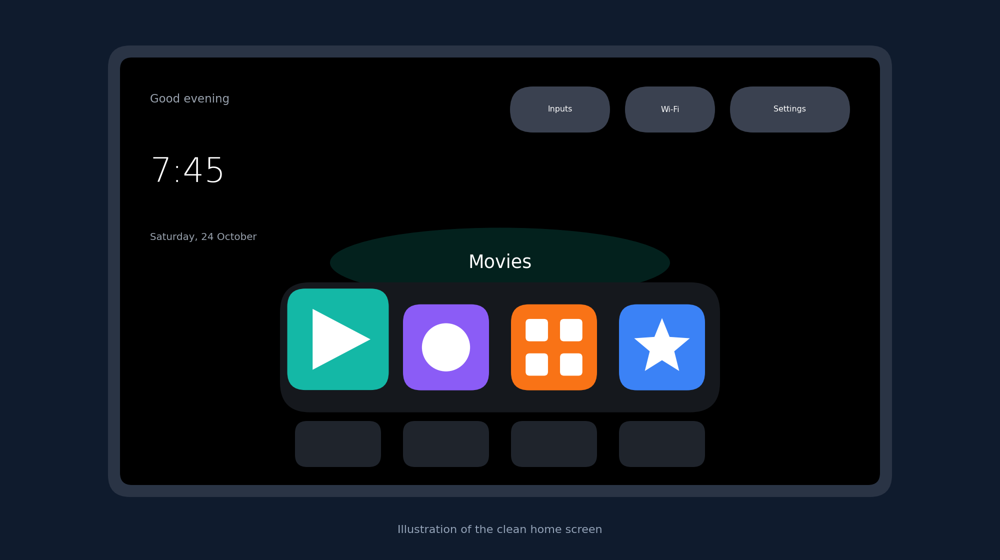
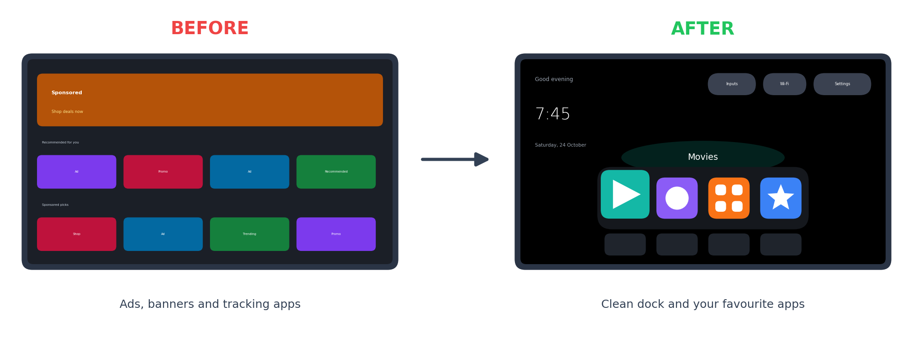
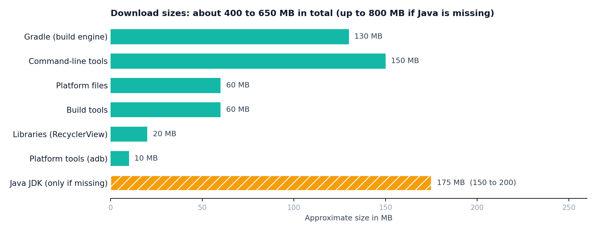
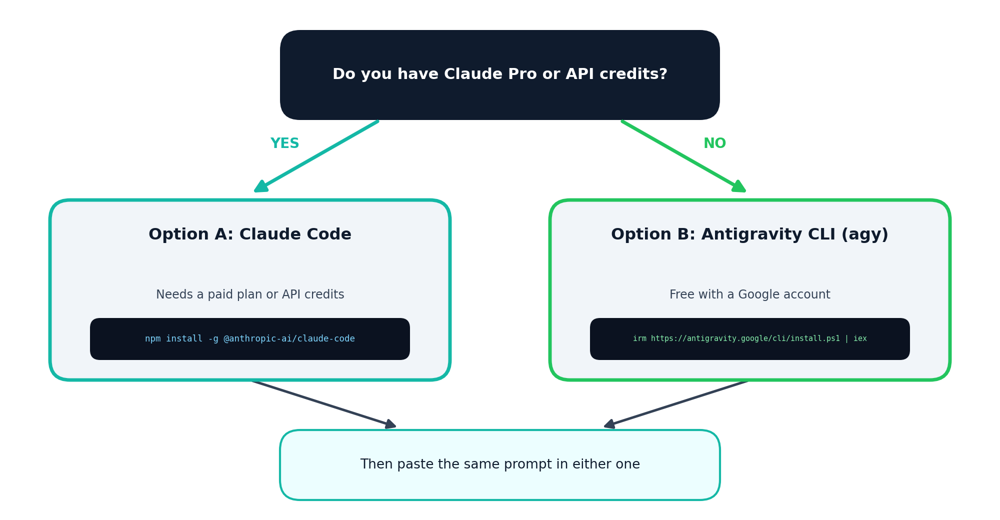

# fire-tv-stick-cleanup-guide.
This repository is for hose who do not own the Calude Code PRO or MAX subscription

# Fire TV Cleanup: Step by Step Setup Guide

Remove the ads and extra apps from your Android TV, Google TV or Fire TV. Then give it a clean home screen with a dock. This guide is made for beginners on Windows and works with a free tool too.




## Credits

This guide is based on the work of others. Please visit and star their repos.

- **[itsmeterrylin/fire-tv-cleanup](https://github.com/itsmeterrylin/fire-tv-cleanup)** is the main project. It holds the prompt, the launcher, the tools and the Fire TV notes.
- **[Gathin23/tv-vibehack](https://github.com/Gathin23/tv-vibehack)** is the original project that started it all.

Both projects use the MIT licence. The launcher, tools and prompt come from them. This guide only explains how to set everything up in simple steps.

## What you get

- A TV without ads and tracking apps
- A clean home screen with a dock for your four favourite apps
- A backup and a restore script, so you can undo everything

Everything is reversible. Apps are switched off and never deleted.

## What you need

- A Windows laptop on the same Wi-Fi as the TV
- An Android TV, Google TV or Fire TV (Samsung Tizen and LG webOS do not work)
- About 1 GB of free data for downloads and 3 GB of free disk space
- 1 to 2 hours of time

## Step 1: Prepare the TV

For Android TV and Google TV:
1. Open Settings, then Device Preferences, then About.
2. Press OK on Build 7 times.
3. Go back and open Developer options.
4. Turn on USB debugging. Turn on Network debugging too if you see it.

For Fire TV:
1. Open Settings, then My Fire TV (or Device & Software), then About.
2. Select the device name 7 times.
3. Go back and open Developer Options.
4. Turn on ADB debugging.

Menu names change a little between models. Keep the TV on for the whole job.

## Step 2: Install the tools on Windows --- not tested on MAC or Apple



### 2.1 Install Node.js
1. Open nodejs.org and download the LTS version.
2. Run the file and click Next until it ends.
3. Open PowerShell and type `node -v`. A number like v22.x.x means it works.

### 2.2 Allow scripts in PowerShell
If you see a message that running scripts is disabled, run this once:

```
Set-ExecutionPolicy RemoteSigned -Scope CurrentUser
```

Type `Y` and press Enter.

### 2.3 Install ADB
1. Open developer.android.com/tools/releases/platform-tools
2. Download SDK Platform-Tools for Windows.
3. Extract it to `C:\platform-tools`.
4. In PowerShell run this for the current window:

```
$env:Path += ";C:\platform-tools\platform-tools"
adb version
```

A version number means it works. Run the first line again if you open a new window.

## Step 3: Pick your coding assistant

You need one assistant with shell access. Pick the one that fits you.



### Option A: Claude Code (needs Claude Pro or API credits)
```
npm install -g @anthropic-ai/claude-code
claude
```
Log in with your Claude account when the browser opens.

### Option B: Antigravity CLI, called agy (free with a Google account)
If you do not have a Claude Pro plan, use this one.

Google has replaced the old Gemini CLI with Antigravity CLI for free accounts. If you try the old Gemini CLI you will see a message that the client is no longer supported. Use agy instead.

```
irm https://antigravity.google/cli/install.ps1 | iex
```

1. Close PowerShell and open it again.
2. Type `agy` and press Enter.
3. Sign in with your Google account in the browser.

On Mac or Linux use this install line:
```
curl -fsSL https://antigravity.google/cli/install.sh | bash
```

Free use has a weekly limit. This job is short and fits well.

## Step 4: Run the prompt

1. Open the prompt file: [PROMPT.md](https://github.com/itsmeterrylin/fire-tv-cleanup/blob/main/PROMPT.md)
2. Copy the full text.
3. Replace the TV model placeholder with your TV model.
4. Open your assistant (`claude` or `agy`) and paste the prompt.
5. Press Enter.

## Step 5: While it runs

1. Accept the Allow USB debugging prompt when it shows on the TV.
2. Let it save a backup first.
3. Answer the checklist questions. Tick only the apps you use.
4. Pick your four dock apps and their order.
5. Look at the screenshots it shows after each step.

A full run takes about 45 to 70 minutes. The launcher build alone takes 10 to 30 minutes. Keep the laptop awake and the TV on.

Download sizes are about 400 to 650 MB in total. It can reach 800 MB if Java is missing.

## Fix common problems

### adb is not recognized
Run the Step 2.3 commands again. The PATH line works only in the window where you typed it.

### The TV turned off or restarted
A poweroff command only shuts the TV down. Nothing is erased. Press the remote power button. If it stays off, unplug it for 60 seconds and plug it in again.

Avoid cutting power while an APK installs or while the TV shows Updating.

### ADB stops working after a restart
Fire TV turns ADB off after a restart. Switch ADB debugging on again in Developer Options. Then run `adb connect TV_IP:5555`.

### Settings shows cant open Amazon settings (Fire TV)
Check the log:
```
adb logcat -c
adb logcat -d | Select-String -Pattern "FATAL|ActivityNotFound|Permission Denial|settings"
```
If you see a Permission Denial for `com.amazon.whasettings`, the launcher button points to a blocked screen. Tell your assistant:

> My launcher Settings button fails with Permission Denial on com.amazon.whasettings. Please use the standard android.settings.SETTINGS intent or a screen that opens from adb on my TV. Never use com.amazon.whasettings. Rebuild, install and test with a screenshot.

The Settings key on your remote opens Settings in the meantime:
```
adb shell input keyevent KEYCODE_SETTINGS
```

Some Amazon packages are protected. Fire OS will not let you switch them off, and that is fine.

### Audio and video are out of sync
1. Test with the TV speakers first.
2. Wireless speakers such as an Echo add delay. Try Audio Sync Tuning in Settings, then Display & Sounds, then Audio.
3. Move the speaker closer to the TV and use 5 GHz Wi-Fi.
4. For movies, a wired soundbar with HDMI ARC gives the steadiest result.

## Undo everything

Run the restore script that the assistant saved in your backup folder. It brings back every switched off app and the stock launcher. Restart the TV after it finishes.

To bring back one app:
```
adb shell pm enable PACKAGE_NAME
```

## Licence

The original projects use the MIT licence. See the LICENSE file in [itsmeterrylin/fire-tv-cleanup](https://github.com/itsmeterrylin/fire-tv-cleanup). The Outfit and Open Sans typefaces use the SIL Open Font License.

This guide is shared for learning. Use it at your own risk and keep your backup safe.
